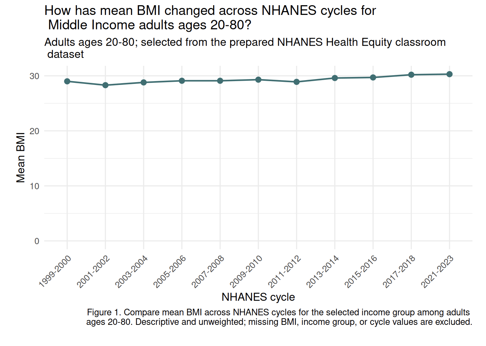

## Context: The Question

**Audience:** Public-health analysts preparing a short briefing for a program-planning team.

**Question:** How did mean BMI change across NHANES cycles for adults ages 20-80 in the middle-income group?

**Why it matters:** A gradual population-level shift may indicate whether a longer-term health trend deserves follow-up, while avoiding an unsupported claim that income caused the change.

## Evidence: A Small Rise Over Time

::: {.columns}
::: {.column width="50%"}
{width="100%"}
:::

::: {.column width="50%"}
### Finding

::: {style="font-size: 70%;"}
* In the prepared classroom dataset, the **unweighted mean BMI among middle-income adults rose from 29.0 in 1999-2000 to 30.3 in 2021-2023**.
:::
:::
:::

::: footer
::: {.small}
Source: CDC/NCHS NHANES public-use data, prepared as the classroom Health Equity dataset [@cdc-nhanes].
:::
:::

## Takeaway: The Main Message
::: {style="font-size: 70%;"}

**Plain-language takeaway:** Among middle-income adults in the classroom sample, average BMI has been fairly stable but moved about 1.3 points higher over 1999–2000.

- It is a **pattern across measurement cycles**, not a year-by-year change nor a causal one.
- The change is **small relative to the full range shown**, so it should not be presented as a crisis or as proof of worsening health.
- BMI describes body weight relative to height and is not a complete measure of health.

:::

## Limitation and Next Step
**Limitation:** These are descriptive, unweighted classroom summaries. They do not represent national estimates and cannot show why BMI changed or establish causation.

**Next step:** Pair this pattern with weighted trend analysis and comparisons across income groups, age groups, and health outcomes before it informs program decisions.

**Revision made from partner feedback:** Added the exact 1.3-point change and clarified that BMI is only one incomplete measure of health.

 
### **References**

::: {#refs}
:::